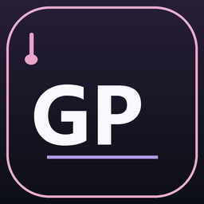

# GP Bridge



**把 Guitar Pro 乐谱转换为面向 Kontakt / VST 音源的 MIDI。**

开发者：**WTdusk** · Windows x64 · Python 3.12+

[下载最新版](https://github.com/WTdusk/GP-Bridge/releases/latest) · [音源预设库](https://github.com/WTdusk/GP-Bridge-Presets) · [反馈问题](https://github.com/WTdusk/GP-Bridge/issues) · [预设提取指南](AGENT_KONTAKT_PROFILE_WORKFLOW.md)

GP Bridge 将乐谱中的弦号、音高和演奏技法转换为 MIDI 音符、Keyswitch、CC 与弯音事件，方便在 DAW 中驱动 Kontakt 等音源。它包含中英双语桌面界面、命令行工具和面向外部 Agent 的 MCP 服务。

**GP Bridge 导出 MIDI，不生成音频，也不包含 Guitar Pro、Kontakt 或商业音色库。** 你需要自行安装相应软件，在 DAW 中加载音源并设置 MIDI 路由。

## 下载与安装

前往 [Releases](https://github.com/WTdusk/GP-Bridge/releases) 下载 Windows x64 版本：

| 文件 | 用途 |
| --- | --- |
| `GPBridge-Setup.exe` | 安装包，可选择安装目录，包含桌面程序、MCP 服务及内置预设 |
| `GPBridge-portable.zip` | 便携版，解压后运行 `GPBridge.exe` |
| `SHA256SUMS.txt` | 用于核对下载文件的 SHA-256 校验值 |

目标电脑无需安装 Python。程序默认将数据保存在安装目录旁的 `GPBridgeData`，建议安装到当前用户可写的目录。安装器默认使用 `%LOCALAPPDATA%\Programs\GP Bridge`。

```text
GPBridgeData/
├─ Profiles/       音源预设 JSON
├─ MIDI/           导出的 MIDI 与转换报告
└─ settings.json   语言、目录和界面选项
```

可以在界面中选择其他预设目录和导出目录。

## 快速使用

1. 打开 `GPBridge.exe`，拖入或选择乐谱。
2. 选择与音源、版本及实际 Keyswitch 设置相符的预设。
3. 选择导出目录；按需要调整连奏重叠、滑弦重叠、按弦分轨和自动延音。
4. 点击 **导出 MIDI**，获得 `.vst.mid` 和 `.vst.report.json`。
5. 在 DAW 中导入 MIDI，加载对应音源并设置路由。

默认启用严格模式：遇到未映射技法时停止导出。关闭后可以导出，但需要检查报告中的警告。JSON 报告还包括来源乐器、音符数、映射组合及自动生成的延音/连奏信息。

## 支持的格式与功能

| 输入 | 支持情况 |
| --- | --- |
| Guitar Pro 6 `.gpx` | 支持 BCFZ 压缩及 BCFS 容器 |
| Guitar Pro 7/8 `.gp`、ZIP `.gpx` | 读取容器内的 GPIF/XML |
| `.gpif`、GPIF/XML | 解析音轨、小节、声部、节奏和音符引用 |
| MusicXML `.xml` / `.musicxml` | 支持 `score-partwise`，保留书写音高及声部时间关系 |

旧版二进制 `.gp3` / `.gp4` / `.gp5` 和压缩 MusicXML `.mxl` 不在当前支持范围。

- 每个来源乐器保留独立轨道及 MIDI Port；可以进一步按弦拆分。
- 预设支持分弦通道、Keyswitch、CC、Program Change、力度规则和组合技法。
- 支持连音线、Let Ring、闷音、断奏、泛音、敲弦、滑弦、Hammer-on / Pull-off、颤音和上行弯音的相应解析或映射；实际效果取决于预设和音源。
- 可选自动延音：普通音符延长至同弦下次起音或该乐器末尾；闷音和断奏保留谱面时值。弦号未知时只延长至同音高下次起音。
- 一个乐器且关闭按弦分轨时导出 Type 0 MIDI；其他情况导出 Type 1 MIDI。

多把吉他的各弦仍使用预设原有通道，例如每把吉他各自使用 1–6。请把每把吉他的轨道分别路由到独立音源实例；DAW 忽略 MIDI Port 时需要手动分配。

## Shreddage 3.5 Archtop 预设

内置 **Shreddage 3.5 Archtop — TACT defaults**。独立维护版本见 [GP-Bridge-Presets](https://github.com/WTdusk/GP-Bridge-Presets)。

在 Kontakt 中：

1. 使用预设对应的默认 TACT Keyswitch 分配。
2. 开启 **MIDI Guitar Mode**，音源 MIDI 输入设为 **OMNI**。
3. Vibrato 控制器设为 **Mod Wheel / CC1**。
4. Pitch Bend 范围设为 **±2 半音**。

弦 1（最高音弦）至弦 6 分别使用 MIDI 通道 1–6。默认 Hammer-on / Pull-off 重叠为 5 ticks，可在界面调整。普通泛音标记默认映射为人工泛音；自然泛音需要乐谱明确标注。GP 弯音高度 25 / 50 / 100 分别按 0.5 / 1 / 2 半音解释，上限为上行 2 半音。

**验证状态：依据手册记录，尚未在实际 Kontakt 实例中验证。** 自定义过 TACT 分配的音源需要同步修改 JSON。详细记录见 [预设验证说明](GPBridgeData/Profiles/kontakt/shreddage_3_5_archtop.verification.md)。

下载其他预设后，将 JSON 放入 `GPBridgeData/Profiles/kontakt/`，重新打开程序，或在界面选择其所在目录。

## 从 PDF 创建预设

点击 **创建预设**，选择官方音源说明书 PDF，填写音色库、乐器名称、支持 PDF 输入的模型、Responses API 地址和 API Key。

- PDF 会发送至你配置的 AI 服务，服务可能产生费用。
- API Key 不写入设置文件。
- 只有通过本地结构、MIDI 数值、页码、证据片段和八度约定检查的结果才会保存。
- 这些检查不能证明模型理解正确，也不能替代 MIDI 监听和音源实测；提取后仍需核对手册。

当前提取过程中关闭对话框不会取消网络请求，结果仍可能写入预设目录。建议等待提取结束再关闭窗口。

## 源码运行

需要带 Tk 的 **Python 3.12+**。Windows 是当前打包和验证平台。

```powershell
git clone https://github.com/WTdusk/GP-Bridge.git
cd GP-Bridge
python -m venv .venv
.\.venv\Scripts\Activate.ps1
python -m pip install -r requirements.txt
python app.py
```

命令行转换：

```powershell
python gpbridge.py song.gpx -c mapping.example.json -o song.vst.mid
```

使用内置 Archtop 预设和自动延音：

```powershell
python gpbridge.py song.gpx `
  -c GPBridgeData/Profiles/kontakt/shreddage_3_5_archtop.json `
  -o song.vst.mid --sustain-mode auto
```

`--report` 可指定报告路径。CLI 预设中的 MIDI 通道从 **1** 开始编号；`sustain_mode` 默认是 `notated`，保留谱面时值及明确的 Tie / Let Ring。

## MCP / 外部 Agent

在 MCP 客户端配置中指定安装后的 `GPBridgeMCP.exe`，通过 stdio 启动：

```json
{
  "mcpServers": {
    "gpbridge": {
      "command": "C:/Users/YOUR_NAME/AppData/Local/Programs/GP Bridge/GPBridgeMCP.exe",
      "args": []
    }
  }
}
```

将路径替换为你的实际安装位置。源码模式可以使用 `.venv/Scripts/python.exe` 作为 command，并将 `mcp_server.py` 的绝对路径作为参数。

| 工具 | 用途 |
| --- | --- |
| `list_presets` | 列出预设，可指定 `folder` |
| `inspect_score` | 查看音符数、调弦、来源乐器、技法和警告 |
| `convert_score` | 指定 `input`、`output`、`preset` 导出 MIDI 与报告 |

`convert_score` 支持 `strict`、`split_tracks`、`sustain_mode` 覆盖。MCP 是能够读取、写入本地文件的本机工具，请仅连接到你信任的客户端。

## 测试与打包

```powershell
python -m pip install -r requirements-dev.txt
python -m pytest -q
.\build.ps1
```

也可显式指定原生 Windows Python：

```powershell
.\build.ps1 -Python C:\Path\To\python.exe
```

脚本生成 `dist/GPBridge.exe`、`dist/GPBridgeMCP.exe`、`dist/GPBridge-portable.zip` 和 `dist/GPBridge-Setup.exe`。安装器使用 Windows .NET Framework C# 编译器构建。图标素材已随源码提供；只有重新生成图标时才需要额外安装 Pillow。

## 已知限制

- MIDI 使用单一速度，不导出完整变速图与拍号图。
- 反复记号当前按书写顺序导出一次，并给出警告。
- 不支持 `score-timewise` MusicXML；请先导出为 `score-partwise`。
- 不可表示为有音高音符的打击乐会报告并跳过。
- 技法是否正确发声取决于音源设置；内置预设尚未完成 Kontakt 实机验证。
- 尚未完成无开发环境的干净 Windows 系统交互验证；macOS / Linux 没有发布包。

反馈时请提供版本、输入格式、预期与实际行为及转换报告，并去除个人路径。只有在你有权分享时再附乐谱。

## 作者与第三方组件

开发者：**WTdusk**。项目尚未指定开源许可证。第三方组件按其各自条款提供，见 [THIRD_PARTY_NOTICES.md](THIRD_PARTY_NOTICES.md) 和 `licenses/`。

GPX 容器实现参考了 [alphaTab 的公开格式读取实现](https://github.com/CoderLine/alphaTab/blob/develop/packages/alphatab/src/importer/GpxFileSystem.ts)，不依赖 alphaTab 运行时。Guitar Pro、Kontakt、Shreddage 等名称属于各自权利人；本项目不包含这些产品或商业采样内容。

---

**English:** GP Bridge converts Guitar Pro GPX/GPIF and partwise MusicXML into MIDI for Kontakt/VST instruments. It provides a bilingual Windows GUI, CLI, and stdio MCP tools. Download the Windows x64 installer or portable ZIP from [Releases](https://github.com/WTdusk/GP-Bridge/releases/latest). No Python installation is required for packaged builds. Instrument profiles are maintained in [GP-Bridge-Presets](https://github.com/WTdusk/GP-Bridge-Presets). The bundled Archtop profile is documented from the manual and has not yet been verified in Kontakt. MIDI currently uses one tempo and plays repeat sections once in written order. Developer: **WTdusk**.
